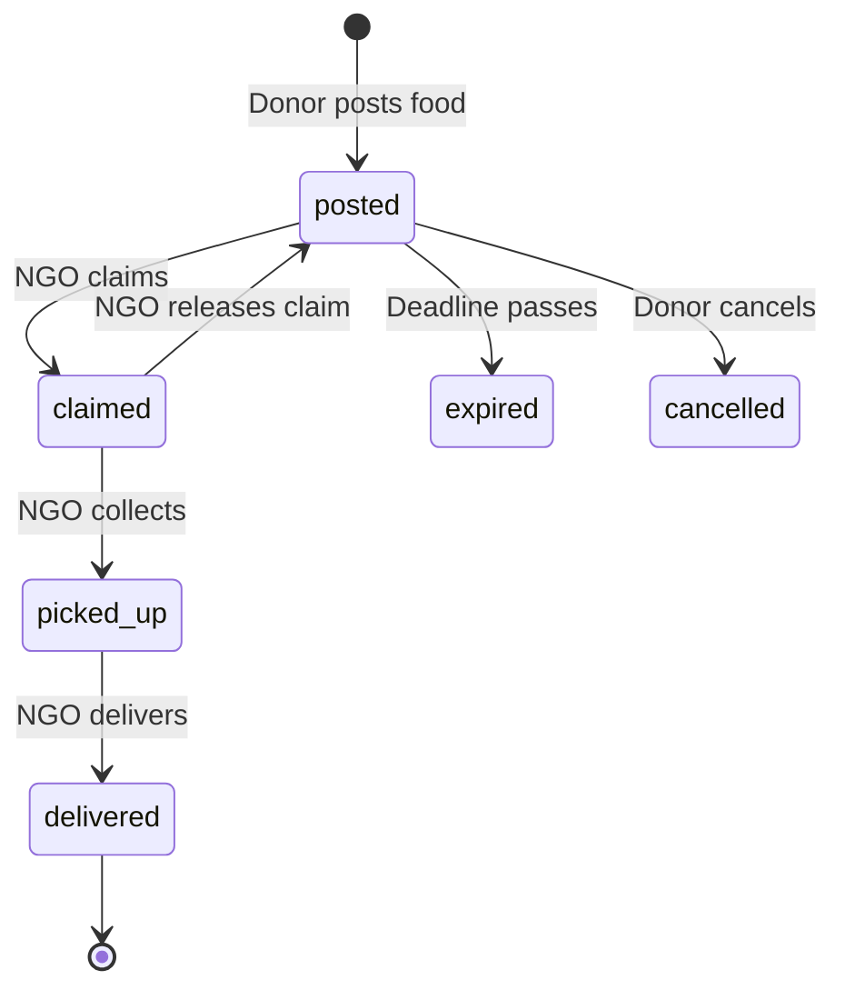

# FoodRescue Connect

A web app that connects people with surplus food (restaurants, caterers, hostels, wedding halls) to NGOs and volunteers who can collect it and deliver it to people in need, before it goes to waste.

Built with Flask and SQLite. No paid services or API keys are needed to run it.

## Features

- **Two roles.** Donors post food; NGOs claim and collect it.
- **Safe by default.** Every listing has a "prepared at" time and a "collect by" deadline. Unclaimed listings expire automatically.
- **Live pickup flow.** `posted -> claimed -> picked up -> delivered`, with timestamps for each step.
- **Map and distance.** Open listings appear on an OpenStreetMap map (Leaflet), and NGOs can sort by distance using the Haversine formula.
- **No double claims.** Claiming is a single atomic database update, so two NGOs cannot take the same food.
- **Privacy.** Donor phone numbers are shown only to the donor and the NGO that claimed the listing.
- **Impact counters.** Servings delivered, in transit and waiting, on the home page and on each dashboard.
- **JSON feed.** `GET /api/listings` returns open listings without contact details.
- **Security basics.** Hashed passwords, CSRF protection on every POST, parameterised SQL, role checks on every action.

## Tech stack

| Layer | Choice |
| --- | --- |
| Backend | Python 3.10+, Flask |
| Database | SQLite (single file, created on first run) |
| Frontend | Jinja templates, plain CSS and JavaScript |
| Maps | Leaflet with OpenStreetMap tiles |
| Tests | pytest, run on every push with GitHub Actions |

## Quick start

```bash
git clone https://github.com/<your-username>/foodrescue-connect.git
cd foodrescue-connect

python -m venv .venv
source .venv/bin/activate        # Windows: .venv\Scripts\activate
pip install -r requirements.txt

flask --app foodrescue init-db   # create the tables
flask --app foodrescue seed-demo # optional demo accounts and listings
flask --app foodrescue run --debug
```

Open http://127.0.0.1:5000.

Demo accounts (local use only), password `demo12345`:

| Role | Email |
| --- | --- |
| Donor | donor@demo.com |
| NGO | ngo@demo.com |

The demo listings are placed around Jalgaon, Maharashtra. Edit `seed_demo()` in `foodrescue/db.py` to use your own city.

For anything beyond local use, set a real secret key: `export SECRET_KEY="a-long-random-string"`.

## How it works



## Project structure

```
foodrescue-connect/
├── foodrescue/
│   ├── __init__.py      # app factory, CSRF protection, error pages
│   ├── auth.py          # register, login, logout, role decorators
│   ├── listings.py      # listings, claim/advance/release/cancel, dashboard, API
│   ├── db.py            # SQLite connection, init-db and seed-demo commands
│   ├── utils.py         # Haversine distance, time-left helpers
│   ├── schema.sql       # database schema
│   ├── templates/       # Jinja templates
│   └── static/          # style.css, app.js
├── tests/               # pytest suite
├── .github/workflows/   # CI
├── wsgi.py
└── requirements.txt
```

## Database

- `users`: id, name, email, password_hash, role (`donor` or `ngo`), organization, phone, city, lat, lng
- `listings`: id, donor_id, title, food_type, is_veg, servings, address, lat, lng, prepared_at, expires_at, notes, status, claimed_by, and a timestamp for each pickup step

See `foodrescue/schema.sql` for the full definition and indexes.

## Running the tests

```bash
pytest -q
```

## Roadmap

These are not built yet and make good next steps:

- Predict surplus patterns per donor (for example, weekday and event trends) with a simple regression model
- Smarter donor-to-NGO matching that weighs distance, capacity and past reliability
- SMS or WhatsApp notifications when a new listing appears nearby
- Ratings for donors and NGOs, and an admin panel to verify organizations
- Docker setup and deployment on a free host
- Hindi and Marathi interface

## Food safety note

This project helps people coordinate. It does not replace food-safety rules. Donors should only list food that is safe to eat, and NGOs should check it before distributing it.

## Contributing

Issues and pull requests are welcome. Please run `pytest` before opening a PR.

## License

MIT. See [LICENSE](LICENSE).

Author: Kunal Sayaee
